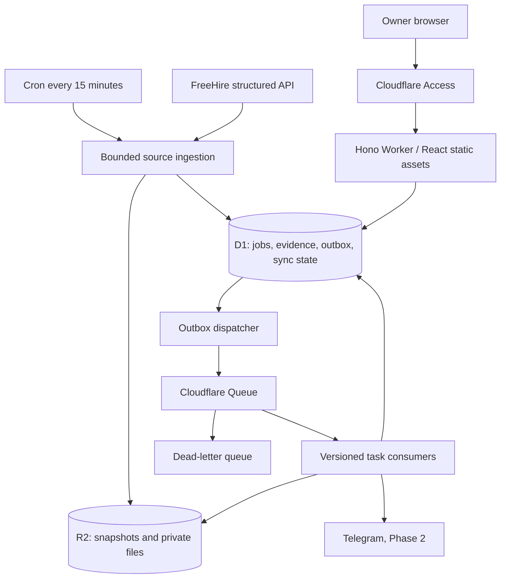

# Architecture

## Runtime and trust boundaries

One Worker exports `fetch`, `scheduled`, and `queue` handlers. Vite builds assets into `apps/web/dist`; all requests pass through the Worker so authentication precedes both API and asset delivery. Hono handles `/api/v1/*`; other authenticated paths use the ASSETS binding and SPA fallback. API misses return JSON 404, never index.html. Keep Workers preview URLs disabled in production.

Access verifies the owner at the edge. The Worker independently verifies JWT signature using the Access team's JWKS, issuer, audience, expiry and configured owner email, and maps the stable subject to one D1 user. Do not trust a plain identity header. Cache JWKS with bounded refresh. Fail closed on missing configuration. A development identity is allowed only by an explicit local environment flag that production startup rejects.

Mutations require same-origin Origin checks and JSON content types (upload routes use bounded multipart). Use restrictive CORS, CSP, secure links and private/no-store responses for personal data. Render descriptions as text or sanitize a narrow HTML allowlist; no raw source HTML in React. Prepared SQL, strict request schemas, body limits and owner scoping apply to every query. Do not fetch user-supplied URLs or automatically follow apply links server-side; allow only HTTP(S) links in the UI. No application submission endpoint exists.

## Domain invariants

Experience eligibility, role suitability, location compatibility, availability and user disposition are separate fields. A score cannot change any of them. Discover queries use `recommended_jobs`, which permits only ELIGIBLE, role ELIGIBLE, location COMPATIBLE, OPEN jobs that have not been ignored. Review and rejected jobs have separate endpoints and explicit labels. A missing score is shown as Pending analysis, never zero.

The configurable experience maximum can be lowered, never raised above two. Required ranges extending above the cap (including 1–3 and 2–4) are rejected conservatively. `2+ required` is rejected even though its lower bound equals the cap. Preferred-only 2+ requirements are REVIEW_REQUIRED, not silently eligible. Missing or conflicting information is REVIEW_REQUIRED. An explicit required >2 statement overrides junior titles, fresher statements and favorable structured data. An LLM cannot override a deterministic rejection.

Scan title and seniority for senior-role exclusions with word boundaries; the description phrase “work with senior engineers” is not title evidence. Parse mandatory and preferred sections independently, preserve evidence spans, units, requirement type and parser version. Handle numeric ranges, plus signs, words, months and Unicode dashes. Distinguish experience from company age, degree length and years since graduation. Irreducible ambiguity goes to review.

Worldwide remote requires explicit geographic eligibility. A US-only remote role is incompatible for an India-based owner; unknown remote scope is REVIEW_REQUIRED. Hybrid and onsite are disabled by default. Work authorization uncertainty is visible and does not imply sponsorship eligibility.

Manual corrections append audit records and trigger reanalysis. Correcting a mistaken experience interpretation requires evidence; it cannot bypass the two-year policy. Overrides, newer source revisions and settings changes invalidate old decisions/scores. Consumer payload revisions must match current versions before publishing results or notifications.

## Ingestion and FreeHire adapter

The documented base is `https://freehire.me/api/v1`; search uses `GET /jobs/search`, `open_within_days=1`, `limit` up to 100 and `offset`. Collections contain `data` and pagination `meta`. Public slugs address jobs; retrieve detail with `GET /jobs/{slug}` when the list does not carry the full description. Detail exposes closed postings. Respect response rate-limit headers and 429 Retry-After. These are API contract facts from [FreeHire documentation](https://freehire.me/docs/api); verify actual wire fields against a captured fixture before implementing normalization.

Our adapter accepts unknown JSON, validates it at the boundary and retains the source payload privately in R2. Field mapping must be based on a recorded real response, not the example schema in the brief. Preserve remote restrictions, full requirements and source attribution/link. Do not POST to FreeHire's application endpoints. Personal use only initially; review source licensing before expanding to other users.

Acquire a D1 compare-and-swap lease per source before fetching. Persist a run's frozen start/window, page offset, retry deadline, counts and errors. Use a configurable request and wall-clock budget and resume unfinished runs on the next trigger rather than truncating silently. Offset pagination can shift during live updates; overlap windows and exact dedupe limit loss, and a periodic wider reconciliation catches shifts. Never advance a completed watermark on partial failure. After downtime, widen the lookback using the last completed watermark; initial backfill is bounded and explicitly separate from recurring sync.

Order: source identity/URL lookup, title rejection, remote compatibility, structured experience, textual experience, skills. Cache or update existing jobs; changed source content increments job revision and requeues analysis. Store rejected summaries/evidence for audit without placing them in Discover. Availability UNKNOWN/EXPIRED/CLOSED never appears as an open recommendation. Refresh retained open jobs by detail in bounded rotating batches; absence from a recent search is not closure. Record last verification time and remove stale unverified jobs from recommendations after a configurable grace period by setting UNKNOWN.

## Identity and deduplication

Use UUIDs for internal records. Preserve every source reference. Try exact and conservative canonical application URL, FreeHire slug, source external ID, then a company/title/location fingerprint. URL canonicalization strips known tracking parameters and fragments, lowercases host and removes default ports; retain requisition IDs and unknown query parameters. Do not equate all company careers URLs. A generic apply URL or fallback fingerprint creates a duplicate candidate unless a requisition identity corroborates it. Fuzzy candidates require review. Exact source identities are unique; race conflicts reload the existing master. Merges preserve applications, source refs, audit evidence and aliases within an atomic D1 batch.

## Durable work and retries

Commit source updates, analysis request and outbox row in one D1 batch. The dispatcher sends pending rows to Queues and marks dispatch afterwards. A crash between send and mark may redeliver: every task uses a stable idempotency key, current input revision and D1 compare-and-swap lease. Consumers commit results and completion together, then acknowledge. Retry transient errors with bounded exponential backoff/jitter and provider Retry-After; route exhausted messages to the DLQ and show actionable sync health. Replaying the same event must not create duplicate applications, resume versions or history records.

Telegram delivery is at-least-once at the network boundary: a timeout after provider acceptance cannot be distinguished from failure. Unique D1 notification intents prevent routine duplicates, but Telegram does not supply a transactional idempotency contract. Mark ambiguous sends UNKNOWN for reconciliation rather than claiming exactly-once delivery. This limitation belongs in Phase 2 acceptance and the operations UI.

## Match engine, Phase 2

Only eligible/open/compatible jobs get recommendation scores: role 25, experience 25, skills 25, location 15, verified-profile relevance 5, freshness 5. Store the breakdown, matched/missing canonical skills, explanation and input versions. Aliases include ReactJS/React, Amazon Web Services/AWS and full-form RAG/LLM. Skill overlap is proportional to relevant job skills, not all owner technologies. Preferences are not verified resume skills. Cap old or missing posted-date freshness and use first_seen as a distinct discovery signal. Default notification threshold 70. Recheck all gates immediately before sending.

## Later phases without premature dependencies

Phase 3 uploads originals to private R2 and records MIME/size/hash/metadata in D1. Parse into unverified facts; owner approval creates a verified fact/bullet bank. Tailoring selects evidence IDs and reorders verified content; validation rejects unsupported skills, metrics or facts. Snapshot profile/job/template versions and a content hash. Generate only on demand unless enabled explicitly. Resume task states: PENDING, RUNNING, READY, FAILED. Stage PDF/DOCX objects before atomically marking metadata ready; clean orphan objects. Worker-compatible parsers/renderers need a feasibility spike; isolate an optional renderer only if necessary. Download through authenticated API, not public bucket URLs.

Phase 4: one application per owner/master job, optimistic versioning, append-only status history written atomically with every update, including Kanban drag. Mark Applied records the chosen ready resume version, URL and applied timestamp. A repeated request returns the same application. Follow-up due derives from seven days after applied/last meaningful response, excludes terminal states, and never sends mail automatically.

Phase 5: OAuth with minimal Gmail read and Sheets scopes, encrypted refresh credentials, revocation/deletion support, verified push envelope or scheduled incremental history polling, persisted cursor and full-resync handling. Store deduped message IDs and limited relevant metadata. Ambiguous email/application matches require review. High-confidence, newer evidence can update status atomically with history; stale confirmations cannot regress interview/offer states. Conflicting terminal events require review. Provider event time and received time are distinct. Sheets uses a hidden stable application ID, versioned upserts and retry outbox; D1 wins conflicts. No outbound Gmail send scope.

## Operations

Structured logs include request/run/task ID, counts, timings and sanitized error code. Never log raw resumes, tokens, email bodies or personal contacts. Health shows last successful sync, pending age, DLQ count and freshness. Separate staging and production databases/buckets/queues; test migrations and backup/restore procedures before production. D1 stores structured truth, R2 stores private artifacts; bucket lifecycle handles snapshots and orphan cleanup. No secret values in settings or browser bundles.
